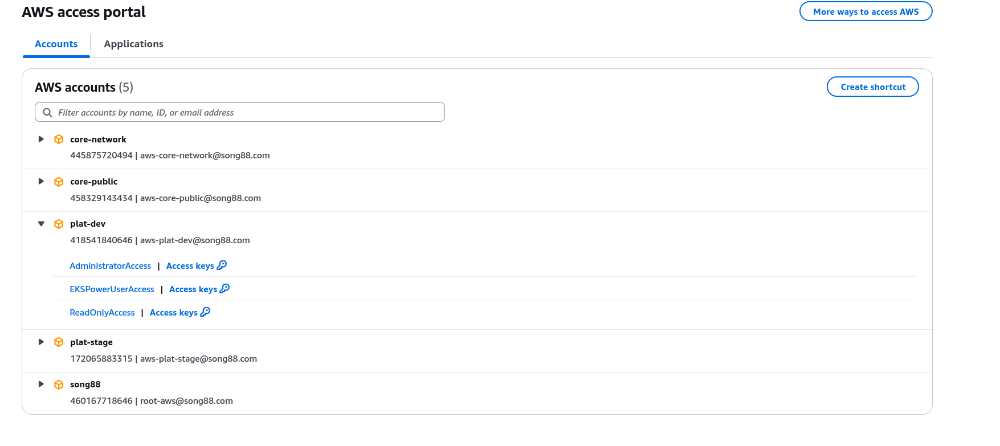

# EKS Access

The following guide showcases the necessary steps in order to get access on any EKS cluster managed
in one of the AWS accounts of song88.

## Login to the AWS SSO

The SSO page is the gateway to the rest of the accounts. Ask DevOps if you don't already have an
account there. Below is the view of the main page showing all the AWS accounts that are available to
you.



Link of the SSO Page: https://d-9667bfe8f0.awsapps.com

You can use the page to login to the AWS console with some predefined permissions. e.g
`AdministratorAccess` will you admin and `ReadOnlyAccess` will only you read access. For EKS you'll
need to have the `EKSPowerUserAccess` permissions if you're on the development team.

## Setup with aws-vault

[aws-vault](https://github.com/99designs/aws-vault) is a CLI tool that we'll be using to get the
necessary credentials loaded in a shell and then be able to authenticate to Kubernetes.

> [!NOTE]
> In this guide we assume access on the `plat-dev` account, but the process is the same for all.

Open `~/.aws/config` (note that this might be different if you're on Windows, so see the relevant
docs in `aws-vault`), and paste the following:

```ini
[profile song88-plat-dev]
sso_start_url = https://d-9667bfe8f0.awsapps.com/start
sso_region = ap-southeast-1
sso_account_id = 418541840646
sso_role_name = EKSPowerUserAccess
region = ap-east-1

[profile song88-plat-dev-eks-developer]
source_profile = song88-plat-dev
role_arn = arn:aws:iam::418541840646:role/eks-developer-access-role
region = ap-east-1
```

> [!NOTE]
> The profile names are arbitrary and can be changed to your liking. Make sure that the `source_profile` name actually match.

Open a shell and run the following

```bash
aws-vault exec song88-plat-dev-eks-developer
```

This will open a browser window asking you to login to the SSO page and approve the login. Once done
you should have valid AWS credentials. Verify with the following

```bash
aws sts get-caller-identity
```

## Access the Kubernetes cluster

Now that the AWS access is properly setup we'll need to login into the cluster.

Using the shell from the previous step run the following commands to find the existing clusters and
add them to your local kubectl context.

```bash
$ aws eks list-clusters --region ap-east-1
{
    "clusters": [
        "song88-sandbox-cluster"
    ]
}

$ aws eks update-kubeconfig --name song88-sandbox-cluster  --alias song88-sandbox-cluster --region ap-east-1
Updated context song88-sandbox-cluster in /home/user/.kube/config

$ kubectl config set-context song88-sandbox-cluster
```

Now you should be able to run normal kubectl commands.

> [!WARNING]
> The developer role has admin access only on the namespace that the apps live, so add the -n flag in your commands to specify the namespace.

The namespace for the apps currently is `bet-genius-apps`.

```bash
# This should give you the running containers in the namespace
kubectl get pods -n bet-genius-apps

# This should port forward the rabbitmq management UI in localhost.
kubectl port-forward svc/rabbitmq-main-cluster 15672 -n bet-genius-apps
```

See the [kubectl docs](https://kubernetes.io/docs/reference/kubectl/) for all the commands and
options available.
